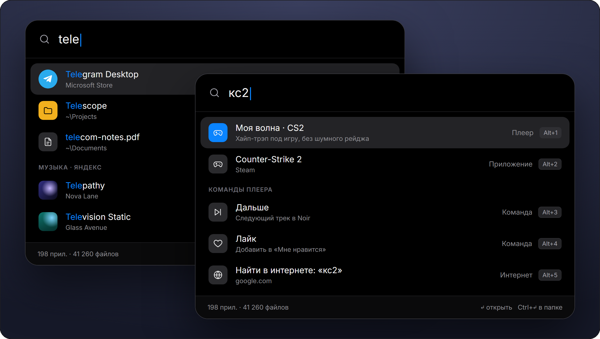

<div align="center">

# Launcher

**Свой Raycast для Windows 11**

Одна строка вместо меню «Пуск»: приложения, файлы, музыка и команды — по <kbd>Alt</kbd> + <kbd>Q</kbd>.

[](https://github.com/trualontuu/launcher/releases/latest/download/Launcher.zip)


[](https://github.com/trualontuu/launcher/releases/latest)



<sub>Макет: файлы и треки выдуманные.</sub>

</div>

## Установка

> Нужна Windows 11 (64-бит). Ставить .NET не нужно — всё уже внутри.

1. Скачай **[Launcher.zip](https://github.com/trualontuu/launcher/releases/latest/download/Launcher.zip)** и распакуй в любую папку, например `Документы\Launcher`.
2. Запусти `Launcher.exe` — окна не будет, лаунчер ждёт в трее.
3. Нажми <kbd>Alt</kbd>+<kbd>Q</kbd> и начинай печатать. Первые секунды он индексирует файлы, дальше всё мгновенно.

Автозапуск и горячая клавиша — в меню значка в трее. Папки для поиска и сокращения — в «Настройках» того же меню (файл откроется в Блокноте).

<details>
<summary><b>Windows пишет «Windows защитила ваш компьютер»</b></summary>

Программа не подписана платным сертификатом. Нажми **«Подробнее» → «Выполнить в любом случае»**. Окно появляется только при первом запуске.
</details>

<details>
<summary><b>Alt + Q уже чем-то занят</b></summary>

Поменяй сочетание в меню трея или в `%APPDATA%\Launcher\settings.json` (поле `Hotkey`, например `"Ctrl+Space"`).
</details>

<details>
<summary><b>Как удалить</b></summary>

Выключи автозапуск в меню трея, закрой лаунчер («Выход» там же) и удали папку. Настройки лежат в `%APPDATA%\Launcher`.
</details>

## Что умеет

| | |
|---|---|
| ⚡ **Свой индекс** | приложения из «Пуска» и десятки тысяч файлов в памяти — без Windows Search и Everything; результаты появляются по мере ввода |
| 🎵 **Музыка из строки** | ищет треки в Яндекс Музыке и запускает их в [Noir](https://github.com/trualontuu/player) |
| 🧠 **Учится на тебе** | запоминает, что ты чаще открываешь, и понимает сокращения: «тг» → Telegram |
| 🌐 **Поиск в интернете** | если ничего не нашлось — последняя строка ищет запрос в Google |
| 🪶 **Лёгкий** | ~60 МБ памяти, 0% процессора в простое |

### Команды

Работают, когда [Noir](https://github.com/trualontuu/player) распакован в `%LOCALAPPDATA%\Programs\Player` (как в его инструкции):

| Напиши | Что будет |
|---|---|
| `пауза` · `играть` | пауза / продолжить |
| `дальше` · `назад трек` | следующий / предыдущий трек |
| `волна` · `кс2` | «Моя волна» или режим CS2 |
| `лайк` | лайк текущему треку |

### Клавиши

| | |
|---|---|
| <kbd>Alt</kbd>+<kbd>Q</kbd> | открыть / закрыть |
| <kbd>Enter</kbd> | открыть результат |
| <kbd>Alt</kbd>+<kbd>1</kbd>…<kbd>9</kbd> | открыть результат по номеру |
| <kbd>Ctrl</kbd>+<kbd>Enter</kbd> | показать в папке |
| <kbd>Ctrl</kbd>+<kbd>C</kbd> | скопировать путь |
| <kbd>Esc</kbd> | спрятать |

## Для разработчиков

<details>
<summary><b>Сборка из исходников</b></summary>

Нужен [.NET 10 SDK](https://dotnet.microsoft.com/download). Часть кода общая с [Island](https://github.com/trualontuu/island) — репозитории должны лежать рядом:

```
projects/
  island/
  launcher/   ← этот репозиторий
  player/
```

```
git clone https://github.com/trualontuu/island
git clone https://github.com/trualontuu/launcher
cd launcher
dotnet publish -c Release -o dist
```

Проверка без окна: `Launcher.exe --snap <папка> "запрос1" "запрос2"` — снимки выдачи и замеры в `report.txt`.

Настройки — `%APPDATA%\Launcher\settings.json`: горячая клавиша, папки для индекса (`Roots`, `ExtraRoots`), исключения (`Exclude`), сокращения (`Aliases`), поисковик (`WebSearch`).
</details>
